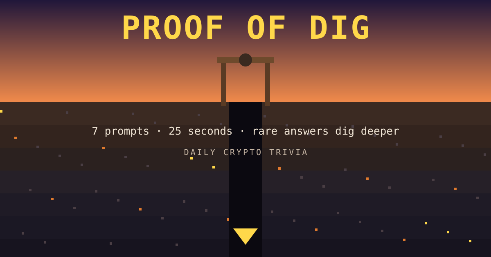
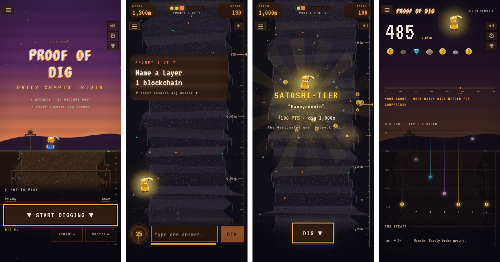

<p align="center">
  <a href="https://proof-of-dig.vercel.app"></a>
</p>

<h1 align="center">Proof of Dig</h1>

<p align="center">
  <b>Daily crypto trivia where the rare answers win.</b><br>
  7 prompts · 25 seconds each · one answer per prompt · new puzzle every day
</p>

<p align="center">
  <a href="https://proof-of-dig.vercel.app"><b>▶ Play now at proof-of-dig.vercel.app</b></a>
</p>

<p align="center">
  
</p>

---

## How to play

1. **Get a prompt.** Something like *"Name a Layer 1 blockchain"* or *"Name a memecoin with a dog in it."*
2. **Type one answer in 25 seconds.** Any correct answer counts. `$TICKERS`, nicknames and small typos are fine.
3. **Dig.** The more obscure your correct answer, the deeper your miner digs and the more points you score.

Everyone gets the same 7 prompts each day. The puzzle resets at midnight New York time. When you're done, share your dig on CT.

## Scoring: think rare

Saying "Bitcoin" is correct. Saying something only a true degen would know is *more* correct.

| Tier | Points | What it means |
|---|---|---|
| 🪨 **Normie** | 10 | The answer everyone blurts out |
| 🤡 **Midcurve** | 15 | Thought it was galaxy-brained. So did everyone |
| ⛏️ **Holder** | 30 | Solid pick |
| 💎 **Degen** | 60 | Uncommon. Diamond hands |
| 🦴 **OG** | 85 | Few remember. You do |
| 🪙 **Satoshi-tier** | 100 | The one hidden gem per prompt. Bedrock gold |

A perfect day is **700 points** (7,000 m deep). Tiers aren't fixed forever: every night the game re-ranks answers based on what players actually typed, so an answer everyone thinks of slides toward Normie.

## What's inside

- **630 hand-written prompts** (90 days) with **20,000+ accepted answers**, from history and DeFi to memecoins, rugs and CT lore
- **Share card** made for screenshots: your score, depth, and a row of tier icons for the day
- **Logbook and streaks** saved in your browser (no account, no wallet, no sign-up)
- **Practice mode** once you've finished the daily
- **Pixel-art mine shaft** with crypto history carved into the walls on the way down (genesis block, the pizza, Mt. Gox, FTX…)
- **Free and open source.** No tokens, no ads, not financial advice

---

## For developers

<details>
<summary><b>Run it locally</b> (Node.js 24+, no accounts needed)</summary>

```sh
npm ci
npm run build
npm run dev
```

Open http://localhost:3051. With no puzzle bank loaded you get 7 built-in sample prompts. Add `?theme=sea` to preview the alternate ocean theme.

Tests: `npm test`. Browser walkthroughs: `node scripts/browser-audit.mjs <url>` and `node scripts/mobile-flow-audit.mjs <url>` (point them at a dev server with an empty database, e.g. `PORT=3052 TURSO_DATABASE_URL=file:/tmp/audit.db npm run dev`).
</details>

<details>
<summary><b>How it works</b></summary>

- **Server-scored.** The server owns the clock and the scoring, so answers stay hidden until you finish the day.
- **Plain JavaScript** front end (canvas pixel art, Web Audio sound) with a small Node handler, running as one Vercel function on a Turso (SQLite) database.
- **Daily puzzles** come from a private bank, so nobody can read tomorrow's answers on GitHub. Each date's puzzle is frozen the first time it's served.
- **Nightly re-ranking** (`/api/cron/retier`) uses real player answers to move tiers. After day 90 the bank reruns from day 1 with the updated tiers.
- **Themes are swappable.** The art, copy and sounds live in `public/themes/` (`mine` by default, `sea` as an alternative).
</details>

<details>
<summary><b>Puzzle bank: public code, private answers</b></summary>

This repo only ships a small labeled sample (`src/sample-bank.mjs`). The real bank lives in a private repo:

- **Format:** one file per day (`days/0001.json` …). Each has 7 prompts with `id`, `text`, `category` and `answers[]` of `{answer, tier, aliases}`, plus exactly one `satoshi` gem per prompt.
- **Validate:** `npm run validate-bank -- ../crypto-trivia-bank/days`
- **Load:** `npm run seed -- ../crypto-trivia-bank/days`. This uses `TURSO_DATABASE_URL`, and day 1 is `LAUNCH_DATE`. Reseeding never changes a day that's already being played.
- **Find missing answers:** `npm run rejections` lists the most common rejected guesses.
</details>

<details>
<summary><b>Deploy your own (Vercel + Turso, free tiers)</b></summary>

1. `npx vercel login`, then `npx vercel link`.
2. `npx vercel integration add tursocloud/database` (free plan). This sets `TURSO_DATABASE_URL` and `TURSO_AUTH_TOKEN`.
3. Load the env with `set -a; . ./.env.local; set +a`, then run `npm run db:migrate` and `LAUNCH_DATE=YYYY-MM-DD npm run seed -- <bank>/days`.
4. Add `CRON_SECRET` (`openssl rand -hex 32`) and `LAUNCH_DATE` as production env vars.
5. `npx vercel deploy --prod`, or push to `main` with the GitHub integration.
6. Check that `/api/health` shows `"database":true`.

`vercel.json` pins `"framework": null` on purpose. Without it, Vercel guesses a Node server and runs the browser script as the server.
</details>

## Credits & license

Built on [OpenKrillion](https://github.com/VulcanEon/openkrillion.com-service) (MIT), an open-source take on the daily rare-answer format. Not affiliated with Krillion or OpenKrillion. Pixel font: VT323 (OFL).

MIT licensed. See [LICENSE](LICENSE) and [THIRD_PARTY_NOTICES.md](THIRD_PARTY_NOTICES.md).
